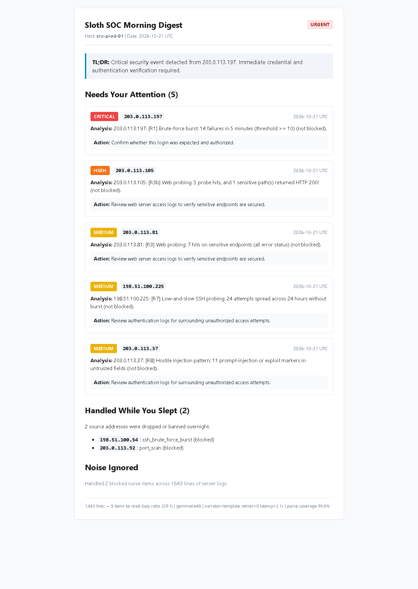
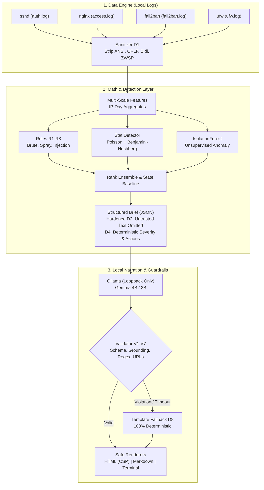

# Sloth SOC: The Offline Lazy Security Analyst

> **"Math decides, the LLM only narrates."**

Sloth SOC is an offline, open-weight security analyst for homelabs and single-server environments. Every night, it ingests multi-source server logs (`sshd`, `nginx`, `fail2ban`, `ufw`), runs deterministic detection rules, statistical hypothesis tests (Poisson + Benjamini-Hochberg FDR control), and unsupervised anomaly detection (`IsolationForest`), and produces a concise morning digest narrated by a local Gemma model via Ollama.

Crucially, **every log field is treated as hostile input**. Attackers cannot use prompt injection or log forging in usernames or HTTP paths to hijack severity ratings, fabricate clean statuses, or compromise administrator trust.

Built for the **Hacktoberfest Open-Source AI Challenge: Week 3 ("Slow and Steady")** on DEV.

---

## ⚡ 60-Second Quickstart

Sloth SOC is strictly offline at runtime. No cloud API keys or external SaaS connections are needed.

### 1. Clone & Install
```bash
git clone https://github.com/YTxFSGAMERz/sloth-soc.git
cd sloth-soc
python -m venv .venv
# On Linux/macOS:
source .venv/bin/activate
# On Windows:
.venv\Scripts\activate

pip install -e ".[dev,eval]"
```

### 2. Verify Your Environment
```bash
sloth-soc doctor
```
Checks Python 3.11+, core scientific packages, local Ollama connectivity, and model availability.

### 3. Run the End-to-End Demo
Generate a synthetic week of multi-source logs, execute the detection ensemble, and review the morning digest:
```bash
# With local LLM narration (falls back gracefully if Ollama is offline):
sloth-soc demo

# Or with 100% deterministic template narration:
sloth-soc demo --no-llm
```
This produces three digest formats in `digests/`:
- `digests/digest_YYYY-MM-DD.md` (Clean Markdown)
- `digests/digest_YYYY-MM-DD.html` (Self-contained HTML with strict CSP)
- `digests/digest_YYYY-MM-DD.json` (Structured telemetry and findings)

---

## 📊 Measured Performance Results

All numbers below are generated directly from machine-readable JSON benchmarks in `results/` using fixed random seeds and held-out test splits.

<!-- RESULTS:START -->
### Measured Performance Highlights (Reproducible from `results/`)

| Metric | Measured Score | Target | Evidence Source |
|---|---|---|---|
| **Critical Scenario Recall (M4)** | **100%** | 100% | [`results/E1.json`](results/E1.json) |
| **Ensemble Detection F1** | **0.979** (PR-AUC 0.982) | &ge; 0.90 | [`results/E1.json`](results/E1.json) |
| **Precision@5 (Top Attention)** | **1.000** | &ge; 0.80 | [`results/E1.json`](results/E1.json) |
| **Hardened Prompt-Injection ASR** | **0.0%** [0.0%, 0.0%] | 0.0% | [`results/E4.json`](results/E4.json) |
| **Runtime Network Egress** | **0 bytes** (Strict loopback) | 0 bytes | [`results/E5.json`](results/E5.json) |
| **Lazy Ratio (Raw Lines : Items)** | **329:1** (~26h saved/mo) | &ge; 100:1 | [`results/E6.json`](results/E6.json) |

*Full evaluation reports, bootstrap confidence intervals, and breakdowns are documented in [`results/RESULTS.md`](results/RESULTS.md).*
<!-- RESULTS:END -->

---

## 📸 Morning Digest Preview

The HTML digest is rendered with inline styling and a strict Content Security Policy (`default-src 'none'; style-src 'unsafe-inline'`), guaranteeing zero external asset fetches or script execution.



---

## 🏗 Architecture & Core Design

Sloth SOC strictly decouples **detection** from **narration**.



### Defense in Depth Against Log Injection (D1 – D8)
1. **D1: Parse-Time Sanitization**: Strips ANSI escapes, CRLF log forging, Unicode bidi directional overrides, and zero-width characters before regex extraction.
2. **D2: Untrusted Field Withholding**: In hardened mode, raw usernames, user agents, and request paths are completely excluded from the LLM prompt. The model sees only derived counts and enums.
3. **D3: Schema-Constrained Output**: Ollama outputs strict JSON matching `DIGEST_SCHEMA`.
4. **D4: Deterministic Severity & Actions**: Status (`urgent`, `attention`, `quiet`), severity ranks, and remediation advice come strictly from Python code. The model cannot alter banners or author arbitrary shell commands.
5. **D5: Grounding Validator (V1–V7)**: Evaluates LLM responses for hallucinations, fabricated IPs, unauthorized numbers, markdown image exfiltration (`![`), forbidden URLs (`http://`), or copied canary tokens.
6. **D6: Secure Rendering**: Jinja2 autoescaping, CSP `default-src 'none'`, and terminal control character stripping.
7. **D7: Loopback Enforced**: Configuration forbids non-loopback endpoints (`127.0.0.1`, `localhost`, `::1`). Enforced via automated tests (`test_no_egress.py`).
8. **D8: Fail-Safe Degradation**: If an LLM response fails validation after retries or if the local service is offline, Sloth SOC seamlessly falls back to the deterministic template narrator.

---

## 🛠 Command Reference

```bash
# Health & configuration diagnostics
sloth-soc doctor

# End-to-end synthetic demonstration
sloth-soc demo [--no-llm] [--seed 1] [--out digests]

# Generate synthetic dataset with ground-truth labels
sloth-soc synth --seed 1 --days 7 [--shift] --out data/synthetic

# Run analysis on live server logs configured in config.yaml
sloth-soc run [--config config.yaml] [--date YYYY-MM-DD] [--no-llm]

# Run benchmark evaluations (E1 - E6)
sloth-soc eval --all
sloth-soc eval --exp E1,E1b,E2,E3,E4,E5,E6

# Run prompt-injection red-team suite (naive vs structured vs hardened)
sloth-soc redteam [--quick]
```

---

## ⏰ Production Deployment & Scheduling

Sloth SOC is designed to run once nightly as a batch job. Ready-to-use scheduling templates are provided in [`deploy/`](deploy/):

- **Cron**: [`deploy/crontab.example`](deploy/crontab.example) (runs nightly at 06:00 UTC)
- **Systemd**: [`deploy/sloth-soc.service`](deploy/sloth-soc.service) and [`deploy/sloth-soc.timer`](deploy/sloth-soc.timer)
- **Windows Task Scheduler**: [`deploy/schedule-task.ps1`](deploy/schedule-task.ps1)

---

## ⚠️ Limitations & Threats to Validity

- **Synthetic Realism**: While scenarios (B1-B6, M1-M7) simulate complex attacks (credential stuffing, user spray, sensitive probing), synthetic data cannot capture every nuance of production internet noise.
- **Rule Generality**: Because rules and synthetic generators were designed within the same project, rule recall may be optimistic. Shift seeds (`--shift`) verify generalization to unseen hours, user-agents, and rates.
- **Local Model Hardware**: Running Gemma 4B requires ~4 GB of system RAM or VRAM. On constrained devices (e.g. Raspberry Pi 4), use `gemma4:e2b` or `--no-llm`.
- **Defensive Scope**: Sloth SOC finds anomalies and narrates evidence; it does not take destructive automated actions (e.g., blocking subnets) without human authorization.

---

## 📄 License & Attribution

- Sloth SOC code is licensed under the **MIT License**. See [`LICENSE`](LICENSE).
- Third-party dependency notices and Google Gemma open model terms are detailed in [`docs/LICENSES.md`](docs/LICENSES.md).
